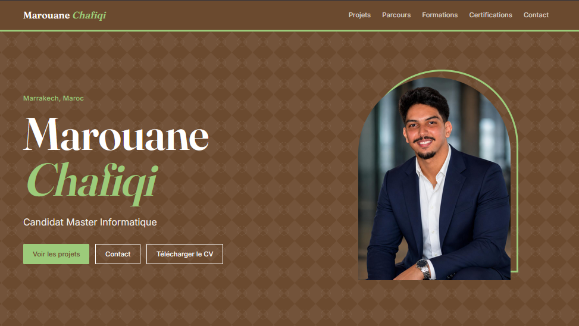
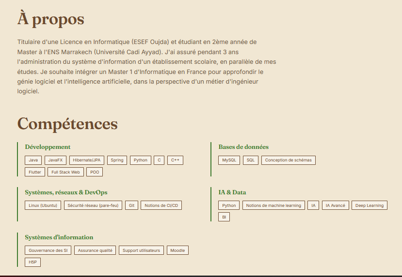
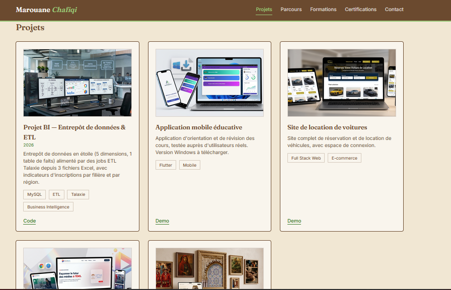
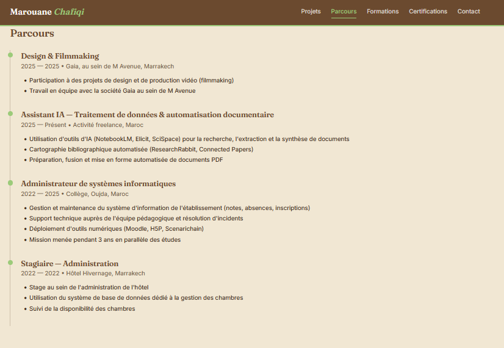
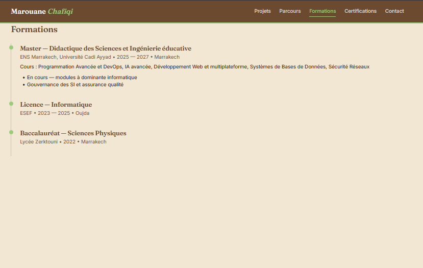
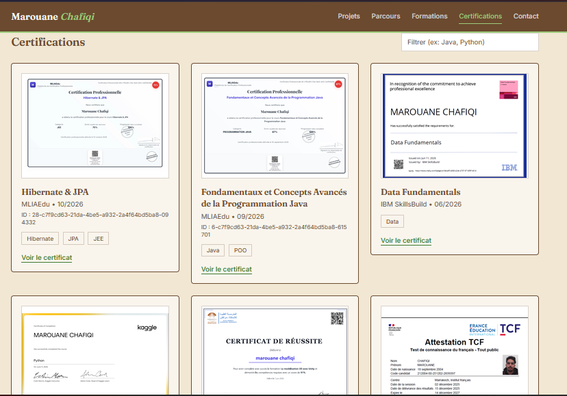
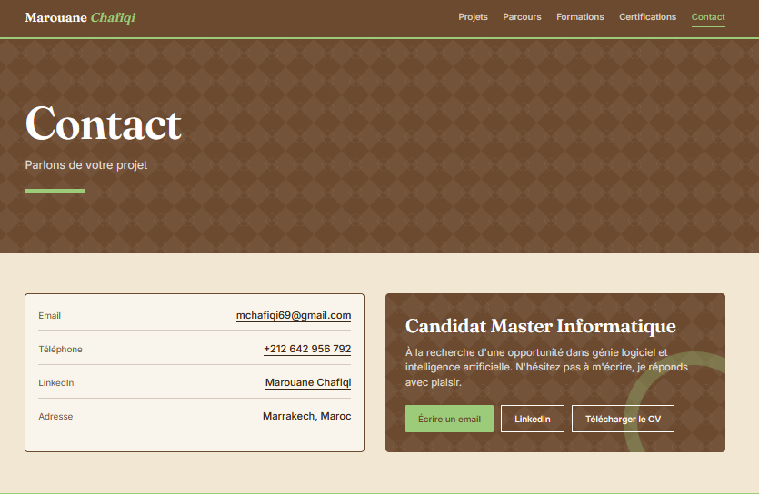

# Portfolio — Marouane Chafiqi

Mon portfolio personnel. J'y présente mon parcours, mes projets et mes certifications.

## Aperçu

| Accueil | À propos et compétences |
|---|---|
|  |  |

| Projets | Parcours |
|---|---|
|  |  |

| Formations | Certifications |
|---|---|
|  |  |

| Contact |
|---|
|  |

## Ce que contient le site

- **Accueil** : présentation et compétences
- **Projets** : mes réalisations (Java, Flutter, web, BI...)
- **Parcours** : mes expériences professionnelles
- **Formations** : mes études
- **Certifications** : mes certificats, avec un filtre de recherche
- **Contact** : email, téléphone, LinkedIn et téléchargement du CV

## Technologies

React · TypeScript · Vite · Tailwind CSS · React Router · Framer Motion

## Lancer le projet

```bash
npm install
npm run dev
```

Puis ouvrir `http://localhost:5173`.

## Contact

Marouane Chafiqi — Marrakech, Maroc
[LinkedIn](https://www.linkedin.com/in/marouane-chafiqi-596ab0257/)